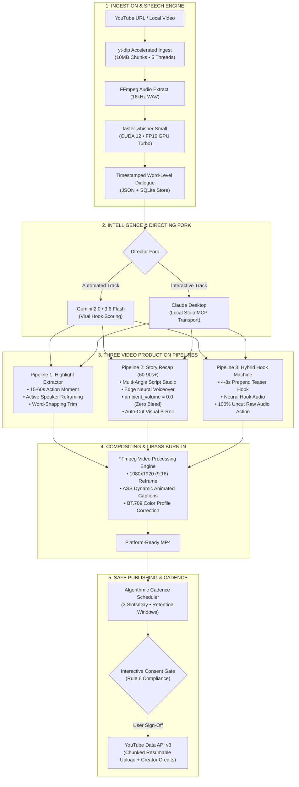
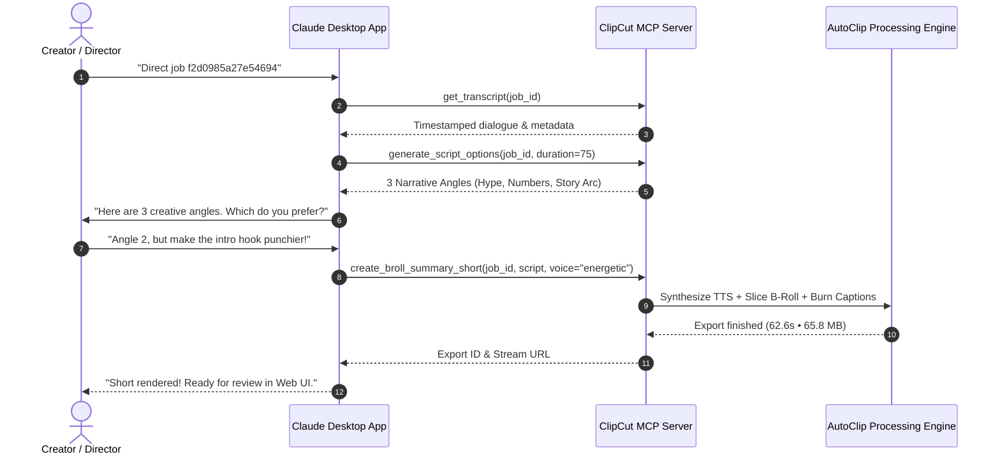

# ClipCut AI Studio

<div align="center">

**Autonomous Multi-Pipeline AI Video Engine for High-Retention YouTube Shorts & Reels.**

Transform long-form YouTube videos and podcasts into captivating 9:16 vertical content. Choose between automated AI generation or deep human-in-the-loop directing via Claude Desktop MCP.

[](LICENSE)
[](https://www.python.org/)
[](https://developer.nvidia.com/cuda-toolkit)
[](https://react.dev/)
[](https://tailwindcss.com/)
[](https://modelcontextprotocol.io/)

[Key Features](#key-features) •
[Architecture](#system-architecture) •
[The 3 Pipelines](#the-3-video-generation-pipelines) •
[Claude Desktop MCP](#directing-via-claude-desktop-mcp) •
[Smart Posting Cadence](#smart-posting-cadence--retention-scheduler) •
[Quickstart](#quickstart--installation) •
[License](#credits--license)

</div>

---

## Key Features

- **3 Dedicated Production Pipelines:** Choose from Highlight Extraction (P1), 60–90s+ Multi-Angle Story Recap with 100% clean studio audio (P2), or Viral Hybrid Teaser Hook Injection (P3).
- **Dual-Director Architecture:** Generate autonomously via Google Gemini Flash or step into Director Mode via Claude Desktop through the local Model Context Protocol (MCP) server.
- **Modern Hormozi & Neon Captions:** Word-by-word animated ASS subtitles (`Hormozi Punch`, `Neon Gold`, `Bold Pop`, `Karaoke Fill`) with precise sub-millisecond timestamps.
- **Neural Voice Engine:** Integrated Edge Neural TTS with sub-millisecond word boundaries and diverse expressive voice personas (`Energetic`, `Narrator`, `Storyteller`).
- **Dynamic Scene-Aware Reframing:** Active speaker tracking (MediaPipe FaceMesh), Split-Screen Gamer layout (35% Facecam + 65% Gameplay), and 1.35x Zoom-Fit.
- **Algorithmic Posting Cadence:** Calculates high-retention audience windows (Midday Lunch 12:00 PM, Commute 5:30 PM, Night Prime 8:30 PM) with a strict 3 Shorts/day cap to protect channel authority.
- **Human-in-the-Loop Safe YouTube Publishing:** Mandatory user consent gate, automatic original creator fair-use attribution, and chunked resumable video uploads.
- **100% Local Hardware Acceleration:** Faster-Whisper, PyTorch, cuBLAS 12, cuDNN 12, and NVENC/libx264 hardware encoding.

---

## System Architecture

ClipCut AI is engineered with a modular backend powered by FastAPI and SQLite, coupled with a high-performance React 19 SPA and a local MCP stdio server.



---

## The 3 Video Generation Pipelines

### Pipeline 1: Highlight Extraction & Scene-Aware Reframing
- **Duration:** 15–60 seconds
- **Audio:** 100% raw source dialogue with word-snapping in/out boundaries.
- **Framing Modes:**
  - `Auto (Zoom)`: Dynamic face tracking targeting active speakers.
  - `Split-Screen (Gamer)`: Top 35% facecam + Bottom 65% gameplay separated by an obsidian border line.
  - `Zoom-Fit`: 1.35x zoom fill over blurred background for landscape scenery.
  - `Blur-Fit`: Centered 16:9 canvas over Gaussian-blurred backdrop.

### Pipeline 2: 60–90s+ Multi-Angle Story Recap (Pristine Studio Audio)
- **Duration:** 60–90+ seconds (7-tier narrative escalation)
- **Audio:** **100% Clean Studio Narration (`ambient_volume = 0.0`)**. Solves background dialogue bleed by completely isolating the neural voice track over original background visuals.
- **Creative Angles:** Automatically writes 3 diverse editorial perspectives:
  1. *Viral Hype & Suspense*
  2. *Numbers, Financial Stakes & Shock Value*
  3. *Deep Narrative Story Arc*
- **Iterative Feedback:** Critique and revise scripts in real-time before burning final render.

### Pipeline 3: The Hybrid Hook Machine (Teaser Hook + Raw Action)
- **Duration:** 30–65 seconds
- **Mechanism:** Slices a 2.5–4.5s high-impact visual teaser B-roll from the video, plays an AI-written neural voiceover teaser hook with Hormozi captions over the teaser, and seamlessly transitions to the raw highlight moment with **100% uncut original dialogue intact**.

---

## Directing via Claude Desktop (MCP)

ClipCut AI features a local **Model Context Protocol (MCP)** server over standard stdio transport, allowing you to use Claude Desktop as your executive video director.



### Claude Desktop Configuration
Add the following to your `claude_desktop_config.json`:

```json
{
  "mcpServers": {
    "clipcut": {
      "command": "c:\\Production Ready Projects\\ClipCut\\autoclip\\.venv\\Scripts\\python.exe",
      "args": ["-m", "autoclip.mcp.server"]
    }
  }
}
```

---

## Smart Posting Cadence & Retention Scheduler

To protect your channel from algorithmic spam penalties caused by erratic bulk uploads (e.g. uploading 50 shorts in an hour), ClipCut AI implements an algorithmic schedule manager:

| Window | Local Time | Target Viewer State |
| :--- | :--- | :--- |
| **Slot 1** | **12:00 PM** | **Midday Lunch Peak** — High engagement during lunch and campus breaks. |
| **Slot 2** | **5:30 PM** | **Evening Commute / Rush** — Peak mobile viewing on transit. |
| **Slot 3** | **8:30 PM** | **Night Prime Leisure** — Highest daily dwell time and YouTube algorithm activity. |

- **Dynamic Inspection:** Scans SQLite database for existing uploads.
- **Auto-Advancement:** If today's 3 slots are occupied or passed, automatically reserves tomorrow's earliest prime slot.
- **1-Click Apply:** Click **"Apply Optimal Slot"** inside the publish modal to auto-populate the scheduled release time.

---

## Fair-Use Attribution & Safe Publishing

In strict compliance with creator copyright and platform policies:
- **Mandatory Interactive Consent:** AI never auto-publishes without human sign-off.
- **Automatic Fair-Use Creator Attribution:** Upload descriptions automatically generate and enforce credits:
  ```text
  Highlight from: $1 vs $1,000,000,000 Yacht!
  ----------------------------------------
  Credit to Original Creator:
  Video: "$1 vs $1,000,000,000 Yacht!"
  Creator: MrBeast
  Watch Original: https://youtube.com/watch?v=...
  Transformed under Fair Use for educational recap, analysis, and commentary.
  ----------------------------------------
  #shorts #viral #recap #highlights
  ```

---

## Quickstart & Installation

### Prerequisites
1. **Python 3.11** (Required for MediaPipe & PyTorch compatibility).
2. **FFmpeg with `libass` and `libx264`** (Ensure `ffmpeg` and `ffprobe` are on your PATH).
3. **Node.js 20+** (For building the React frontend).
4. **NVIDIA GPU** with CUDA 12 (Optional, but provides 10x faster transcription & rendering).

### 1. Clone & Set Up Python Virtual Environment
```bash
git clone https://github.com/AradwadTushar/ClipCut-AI.git
cd ClipCut-AI/autoclip

# Create Python 3.11 virtual environment
python -m venv .venv
.\.venv\Scripts\Activate.ps1

# Install package in editable mode with all dependencies
pip install -e .
```

### 2. Verify System Dependencies
```bash
autoclip doctor
```

### 3. Build Frontend & Launch Studio
```bash
# Build React 19 + Vite frontend
cd frontend
npm install
npm run build
cd ..

# Start ClipCut Studio Server
autoclip serve
```
Open **`http://localhost:8000`** in your browser.

---

## Repository Structure

```text
ClipCut-AI/
├── autoclip/
│   ├── backend/autoclip/
│   │   ├── api/             # FastAPI REST endpoints (jobs, clips, tts, youtube)
│   │   ├── db/              # SQLite schema, migrations (v1 -> v2), and CRUD store
│   │   ├── mcp/             # Local Stdio Model Context Protocol (MCP) server
│   │   ├── pipeline/
│   │   │   ├── captions.py  # Hormozi & Neon animated ASS subtitle generator
│   │   │   ├── export.py    # FFmpeg compositing, cropping, and color correction
│   │   │   ├── hybrid.py    # Pipeline 3: Hybrid Teaser Hook Injector
│   │   │   ├── ingest.py    # Multi-threaded yt-dlp downloader
│   │   │   ├── packaging.py # Viral title, hashtag, and fair-use SEO packager
│   │   │   ├── reframe/     # MediaPipe FaceMesh active speaker tracking & zoom-fit
│   │   │   ├── scheduler.py # Smart YouTube posting cadence engine
│   │   │   ├── summarizer.py# Pipeline 2: 60-90s+ Multi-Angle Story Recap
│   │   │   ├── transcribe.py# Faster-Whisper GPU-accelerated STT
│   │   │   ├── tts.py       # Edge Neural Voiceover synthesizer
│   │   │   └── youtube.py   # Resumable chunked uploader & OAuth manager
│   │   └── providers/       # Gemini 2.0/3.6, Claude, and OpenAI drivers
│   ├── frontend/
│   │   ├── src/
│   │   │   ├── components/  # SimpleVideoPlayer, ClipCutLogo, YouTubeUploadModal, TrimBar
│   │   │   ├── pages/       # Landing, Create, JobProgress, Review, Analytics, Settings, History
│   │   │   ├── api.ts       # Typed REST client
│   │   │   └── index.css    # Snow White & Royal Purple light theme palette
│   │   ├── package.json
│   │   └── vite.config.ts
│   ├── tests/               # Pytest test suite (scheduler, boundaries, tts, captions)
│   ├── pyproject.toml
│   └── LICENSE              # MIT License
└── README.md
```

---

## Credits & License

- **Core Engine:** Built upon and adapted from the open-source [AutoClip](https://github.com/artbyjazi/autoclip) project by **Jad Ghazi**.
- **Extensions & Enhancements:** Multi-pipeline architecture (Story Recap, Hybrid Hook), Neural Voice Engine, Claude Desktop MCP, YouTube Smart Scheduler, and ClipCut Studio UI created by **Tushar Aradwad**.
- **License:** Distributed under the **[MIT License](LICENSE)**.
