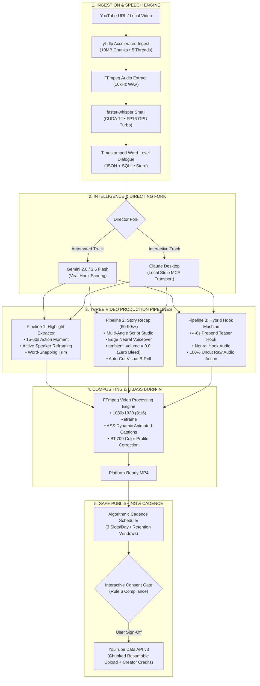
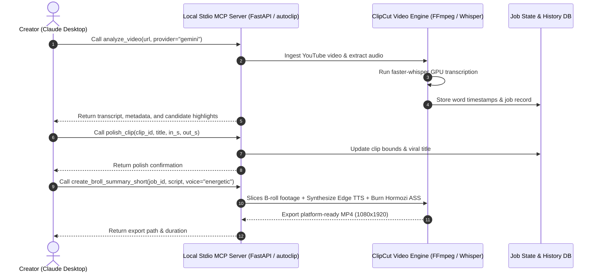

# ClipCut AI Studio

<div align="center">

**Autonomous Multi-Pipeline AI Video Engine for High-Retention YouTube Shorts & Reels.**

Transform long-form YouTube videos and podcasts into captivating 9:16 vertical content. Choose between automated AI generation or deep human-in-the-loop directing via Claude Desktop MCP.

[](LICENSE)
[](https://www.python.org/)
[](https://developer.nvidia.com/cuda-toolkit)
[](https://react.dev/)
[](https://tailwindcss.com/)
[](https://modelcontextprotocol.io/)

[Key Features](#key-features) •
[Quick Download](#instant-download--launch) •
[Architecture](#system-architecture) •
[The 3 Pipelines](#the-3-video-generation-pipelines) •
[Claude Desktop MCP](#directing-via-claude-desktop-mcp) •
[Smart Posting Cadence](#smart-posting-cadence--retention-scheduler) •
[Quickstart](#quickstart--installation-under-2-minutes) •
[License](#credits--license)

</div>

---

## Instant Download & Launch

ClipCut AI comes with pre-compiled production assets. Zero Node.js or development toolchains required.

1. **Download:** Click **[Download Latest ClipCut ZIP](https://github.com/AradwadTushar/ClipCut-AI/archive/refs/heads/main.zip)** and extract the archive to your computer.
2. **Launch:**
   - **Windows:** Double-click `run.bat` (or double-click `ClipCut.vbs` for silent background launch).
   - **macOS / Linux:** Run `./run.sh` in terminal.
3. **Start Creating:** The app automatically launches in a dedicated native desktop window (no browser clutter or URL bar), pins **ClipCut AI Studio** directly to your **Desktop** and **Windows Start Menu**, and starts the interactive tour.

From then on, you never need to open the folder again—just launch **ClipCut AI Studio** directly from your Start Menu or Desktop!

Alternatively, developers can clone via Git:
```bash
git clone https://github.com/AradwadTushar/ClipCut-AI.git
cd ClipCut-AI
run.bat  # On Windows, or ./run.sh on macOS/Linux
```

---

## Key Features

- **3 Dedicated Production Pipelines:** Choose from Highlight Extraction (P1), 60–90s+ Multi-Angle Story Recap with 100% clean studio audio (P2), or Viral Hybrid Teaser Hook Injection (P3).
- **Dual-Director Architecture:** Generate autonomously via Google Gemini Flash or step into Director Mode via Claude Desktop through the local Model Context Protocol (MCP) server.
- **Modern Hormozi & Neon Captions:** Word-by-word animated ASS subtitles (`Hormozi Punch`, `Neon Gold`, `Bold Pop`, `Karaoke Fill`) with precise sub-millisecond timestamps.
- **Neural Voice Engine:** Integrated Edge Neural TTS with sub-millisecond word boundaries and diverse expressive voice personas (`Energetic`, `Narrator`, `Storyteller`).
- **Dynamic Scene-Aware Reframing:** Active speaker tracking (MediaPipe FaceMesh), Split-Screen Gamer layout (35% Facecam + 65% Gameplay), and 1.35x Zoom-Fit.
- **Algorithmic Posting Cadence:** Calculates high-retention audience windows (Midday Lunch 12:00 PM, Commute 5:30 PM, Night Prime 8:30 PM) with a strict 3 Shorts/day cap to protect channel authority.
- **Human-in-the-Loop Safe YouTube Publishing:** Mandatory user consent gate, automatic original creator fair-use attribution, and chunked resumable video uploads.
- **100% Local Hardware Acceleration:** Faster-Whisper, PyTorch, cuBLAS 12, cuDNN 12, and NVENC/libx264 hardware encoding.

---

## System Architecture

ClipCut AI is engineered with a modular backend powered by FastAPI and SQLite, coupled with a high-performance React 19 SPA and a local MCP stdio server.



---

## The 3 Video Generation Pipelines

### Pipeline 1: Highlight Extraction & Scene-Aware Reframing
- **Duration:** 15–60 seconds
- **Audio:** 100% raw source dialogue with word-snapping in/out boundaries.
- **Framing Modes:**
  - `Auto (Zoom)`: Dynamic face tracking targeting active speakers.
  - `Split-Screen (Gamer)`: Top 35% facecam + Bottom 65% gameplay separated by an obsidian border line.
  - `Zoom-Fit`: 1.35x zoom fill over blurred background for landscape scenery.
  - `Blur-Fit`: Centered 16:9 canvas over Gaussian-blurred backdrop.

### Pipeline 2: 60–90s+ Multi-Angle Story Recap (Pristine Studio Audio)
- **Duration:** 60–90+ seconds (7-tier narrative escalation)
- **Audio:** **100% Clean Studio Narration (`ambient_volume = 0.0`)**. Solves background dialogue bleed by completely isolating the neural voice track over original background visuals.
- **Creative Angles:** Automatically writes 3 diverse editorial perspectives:
  1. *Viral Hype & Suspense*
  2. *Numbers, Financial Stakes & Shock Value*
  3. *Deep Narrative Story Arc*
- **Iterative Feedback:** Critique and revise scripts in real-time before burning final render.

### Pipeline 3: The Hybrid Hook Machine (Teaser Hook + Raw Action)
- **Strategy:** Resolves high viewer drop-off in the first 3 seconds of vertical video feeds.
- **Prepend B-Roll Teaser (`hook_mode="prepend_broll"`):** Slices a 2.5–3.5s dramatic B-roll teaser shot from the video climax, overlays high-energy AI voice hook and kinetic captions, then cuts into the main clip with 100% uncut original dialogue and audio.

---

## Directing via Claude Desktop MCP

ClipCut AI exposes its entire video pipeline as a local stdio Model Context Protocol (MCP) server. You can direct, generate, and polish shorts directly inside Claude Desktop.



### Claude Desktop Configuration
Add the server block to your `claude_desktop_config.json`:
```json
{
  "mcpServers": {
    "clipcut": {
      "command": "C:\\Production Ready Projects\\ClipCut\\autoclip\\.venv\\Scripts\\python.exe",
      "args": ["-m", "autoclip.mcp"]
    }
  }
}
```

---

## Smart Posting Cadence & Retention Scheduler

To protect your channel from algorithmic spam penalties caused by erratic bulk uploads, ClipCut AI implements an algorithmic schedule manager:

| Window | Local Time | Target Viewer State |
| :--- | :--- | :--- |
| **Slot 1** | **12:00 PM** | **Midday Lunch Peak** — High engagement during lunch and campus breaks. |
| **Slot 2** | **5:30 PM** | **Evening Commute / Rush** — Peak mobile viewing on transit. |
| **Slot 3** | **8:30 PM** | **Night Prime Leisure** — Highest daily dwell time and YouTube algorithm activity. |

- **Dynamic Inspection:** Scans SQLite database for existing uploads.
- **Auto-Advancement:** If today's 3 slots are occupied or passed, automatically reserves tomorrow's earliest prime slot.
- **1-Click Apply:** Click **"Apply Optimal Slot"** inside the publish modal to auto-populate the scheduled release time.

---

## Fair-Use Attribution & Safe Publishing

In strict compliance with creator copyright and platform policies:
- **Mandatory Interactive Consent:** AI never auto-publishes without human sign-off.
- **Automatic Fair-Use Creator Attribution:** Upload descriptions automatically generate and enforce credits:
  ```text
  Highlight from: $1 vs $1,000,000,000 Yacht!
  ----------------------------------------
  Credit to Original Creator:
  Video: "$1 vs $1,000,000,000 Yacht!"
  Creator: MrBeast
  Watch Original: https://youtube.com/watch?v=...
  Transformed under Fair Use for educational recap, analysis, and commentary.
  ----------------------------------------
  #shorts #viral #recap #highlights
  ```

---

## Quickstart & Installation (Under 2 Minutes)

ClipCut AI comes with pre-compiled production assets. You do not need Node.js or complex development toolchains to run ClipCut.

### Option A: Windows (One-Click Launch)
1. Download or clone this repository:
   - Direct ZIP: Download and extract the [Latest Source ZIP](https://github.com/AradwadTushar/ClipCut-AI/archive/refs/heads/main.zip).
   - Or via Git:
     ```bash
     git clone https://github.com/AradwadTushar/ClipCut-AI.git
     cd ClipCut-AI
     ```
2. Double-click `run.bat`.
   - Automatically detects Python 3.10/3.11 and FFmpeg.
   - Sets up the isolated environment and dependencies.
   - Automatically launches ClipCut Studio in your browser at `http://localhost:8000`.

### Option B: macOS / Linux
```bash
git clone https://github.com/AradwadTushar/ClipCut-AI.git
cd ClipCut-AI
chmod +x run.sh && ./run.sh
```

---

## First-Run Onboarding Tour & Free AI Key
When you launch ClipCut Studio for the first time:
1. An interactive Feature Tour walks you through the 3 video production pipelines, Hormozi captions, active speaker tracking, and smart YouTube scheduling.
2. The final step connects your free AI brain:
   - Paste your Google Gemini API Key ([Get your free key at Google AI Studio](https://aistudio.google.com/app/apikey) -- 100% free, no credit card required).
   - Click "Launch ClipCut Studio" and start generating Shorts immediately.

---

## Getting Updates
When new features or pipeline upgrades are released:
- Windows: Double-click `update.bat`.
- macOS / Linux: Run `./update.sh`.

---

## Manual Developer Setup (Optional)
If you wish to modify the React frontend or extend core pipelines:
1. Python 3.11 environment: `python -m venv .venv && pip install -e .`
2. Frontend dev server / build: `cd frontend && npm install && npm run build`
3. Verify dependencies: `autoclip doctor`
4. Start server: `autoclip serve`

---

## Repository Structure

```text
ClipCut-AI/
├── run.bat                  # One-click Windows launcher
├── update.bat               # One-click Windows updater
├── run.sh                   # One-click macOS / Linux launcher
├── update.sh                # One-click macOS / Linux updater
├── autoclip/
│   ├── backend/autoclip/
│   │   ├── api/             # FastAPI REST endpoints (jobs, clips, tts, youtube)
│   │   ├── db/              # SQLite schema, migrations (v1 -> v2), and CRUD store
│   │   ├── mcp/             # Local Stdio Model Context Protocol (MCP) server
│   │   ├── static/          # Pre-compiled React 19 production bundle (Zero-Node needed)
│   │   ├── pipeline/
│   │   │   ├── captions.py  # Hormozi & Neon animated ASS subtitle generator
│   │   │   ├── export.py    # FFmpeg compositing, cropping, and color correction
│   │   │   ├── hybrid.py    # Pipeline 3: Hybrid Teaser Hook Injector
│   │   │   ├── ingest.py    # Multi-threaded yt-dlp downloader
│   │   │   ├── packaging.py # Viral title, hashtag, and fair-use SEO packager
│   │   │   ├── reframe/     # MediaPipe FaceMesh active speaker tracking & zoom-fit
│   │   │   ├── scheduler.py # Smart YouTube posting cadence engine
│   │   │   ├── summarizer.py# Pipeline 2: 60-90s+ Multi-Angle Story Recap
│   │   │   ├── transcribe.py# Faster-Whisper GPU-accelerated STT
│   │   │   ├── tts.py       # Edge Neural Voiceover synthesizer
│   │   │   └── youtube.py   # Resumable chunked uploader & OAuth manager
│   │   └── providers/       # Gemini 2.0/3.6, Claude, and OpenAI drivers
│   ├── frontend/
│   │   ├── src/
│   │   │   ├── components/  # OnboardingModal, SimpleVideoPlayer, ClipCutLogo, YouTubeUploadModal
│   │   │   ├── pages/       # Landing, Create, JobProgress, Review, Analytics, Settings, History
│   │   │   ├── api.ts       # Typed REST client
```

---

## Credits & License

Engineered on the foundation of AutoClip Core by artbyjazi, extended into an autonomous 3-Pipeline Creator Studio with Edge Neural TTS, Hormozi animations, MediaPipe speaker tracking, Claude MCP directing, and smart YouTube scheduling by Tushar Aradwad.

Licensed under the MIT License.
